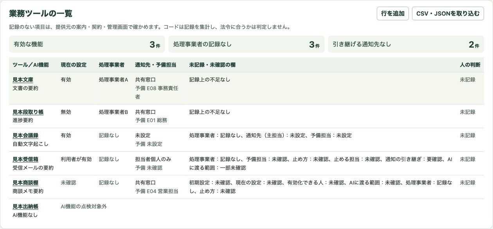
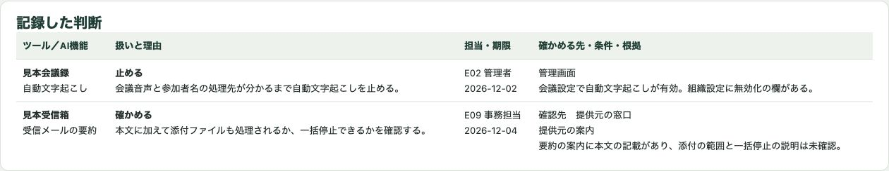
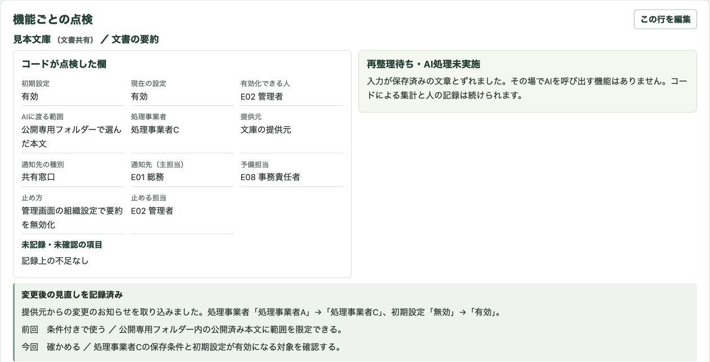
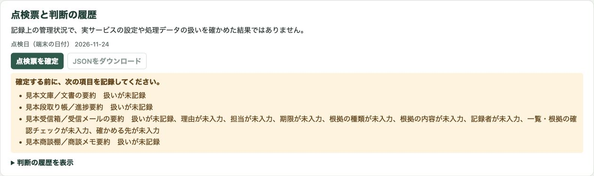
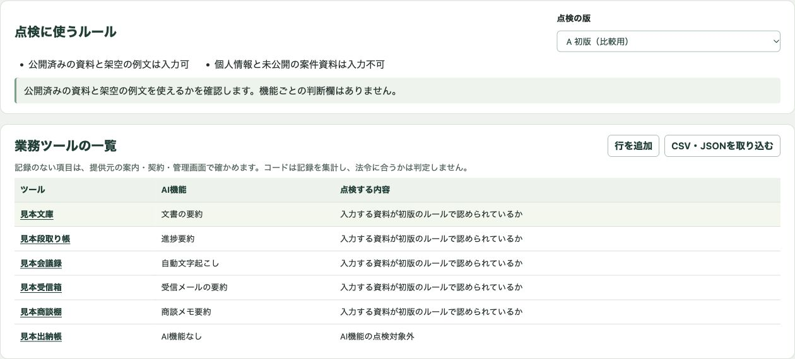
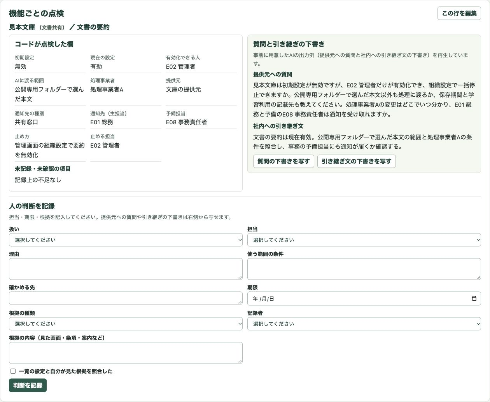
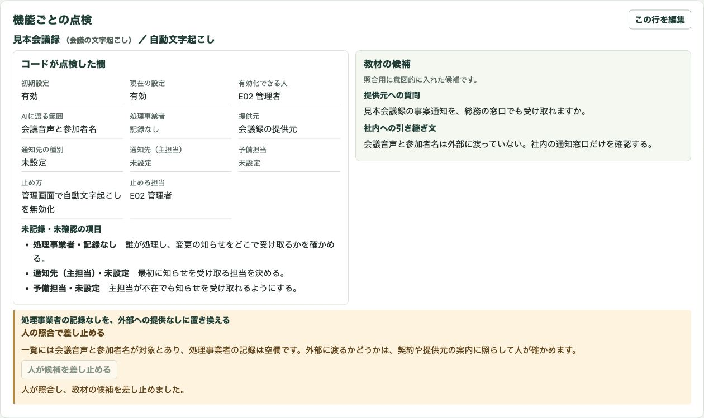
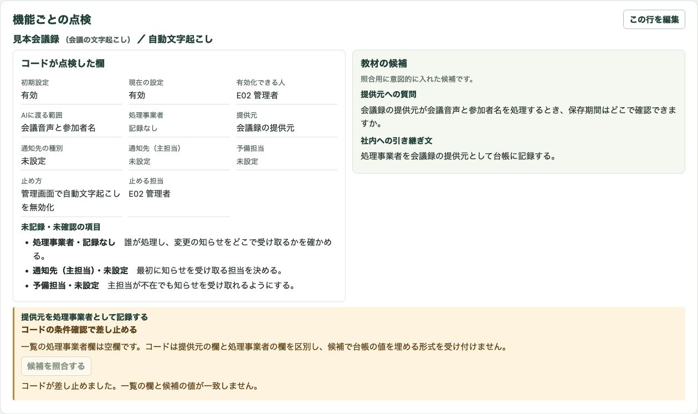

# 架空の会社で、業務ツールのAI機能ごとに設定と処理先を確かめ、人が止める・確かめる・条件付きで使うを決めるデモ

社員15名の見本綴り工房を題材に、営業・事務・制作が使う業務ツール6件を点検する公開デモです。機能ごとに利用判断を記録し、処理先や初期設定の変更後に判断を見直して、点検票を書き出します。

## 題材について

実在の事案の公表を参考に作った架空の題材です。会社・社員・ツール・処理事業者・記録はすべて架空で、導入実績ではありません。

## 画面

| 場面 | 画面 |
| --- | --- |
| 改訂版の一覧。機能の集計と欄ごとの未確認 |  |
| 文字起こしを止め、受信メールの要約を確かめる |  |
| 処理事業者と初期設定の変更を受けて判断を見直す |  |
| 点検票の確定を止めた項目を確かめる |  |
| A 初版。入力の可否を点検 |  |
| B 改訂版。設定や処理先を点検 |  |
| 教材。人が「外部に渡っていない」という候補を差し止める |  |
| 教材。コードが提供元を処理事業者とする候補を差し止める |  |

## 試せること

1. 改訂版の一覧で、欄ごとの記録と未確認の理由を見ます。ツール名から機能ごとの点検を開けます。行を追加・編集でき、CSVまたはJSONを貼り付けて最大100行の一覧を作れます。CSVは画面の英字の見出しを使い、JSONは同じ項目名の行を配列にします。同じ行IDの取り込みは行全体を更新します。
2. 初版と改訂版を切り替え、点検する範囲を比べます。教材では、外部への提供、提供元と処理事業者、通知の引き継ぎ、現在の設定、今後の点検について、照合用に意図的に入れた候補を差し止めます。質問と引き継ぎ文は候補の枠に、差し止めの理由は下の注記に表示します。教材の候補は意図的に作ったもので、AIの自然な失敗を観察した結果ではありません。
3. 改訂版で「止める」「確かめる」「条件付きで使う」「使わないまま」のいずれかと、理由・担当・期限・根拠を記録します。「確かめる」には確認先、「条件付きで使う」には使う範囲の条件も記入します。質問と引き継ぎ文は読み取り専用で表示され、必要なときだけ下書きを写せます。
4. 見本文庫の文書の要約に「条件付きで使う」を記録し、提供元からの変更のお知らせを取り込みます。処理事業者と初期設定が変わり、以前の判断が見直しに回ります。変更後の判断と理由を記録すると、前回の判断も履歴で読めます。「確かめる」の期限が端末の日付より前なら、同じように見直しが必要と表示されます。
5. 判断と必須欄がそろったら、改訂版で点検票を確定し、JSONを表示・ダウンロードします。初版と教材の書き出しは照合用です。

事前に用意したAIの出力例（提供元への質問と社内への引き継ぎ文の下書き）を再生しています（その場でAIを呼んでいない。入力を変えた行は再整理待ちになり、AIは再処理しない）。変更行は「AI処理未実施」と表示され、コードの集計と人の記録は続けられます。

改訂版では、画面の「質問と引き継ぎ文を別途用意する」から一覧と整理の指示をコピーできます。任意の生成AIで別途整理した文章や、人が作った文章を画面に示したJSON形式で貼り付けられます。取り込めるのは現在の版と行の照合キーに合う質問・引き継ぎ文です。編集で照合キーが変わります。

## 実際の業務で使うイメージ

総務が通知を受け取る主担当と予備担当を確かめ、管理者が設定と停止手順を調べ、営業や制作の責任者と利用条件を決める想定です。提供元から変更の案内が届いたら、条件・根拠・期限を見直します。この使い方は想定であり、実績ではありません。

## AI・コード・人の分担

- AIは、提供元への質問と社内への引き継ぎ文を下書きします。実演では保存済みのJSONを再生します。
- コードは一覧の整形、記録と未確認項目の集計、入力検査、版の比較、判断に必要な欄の確認、変更と期限の照合、履歴と書き出しを担当します。法令に合うかは判定しません。
- 人は提供元の案内、契約、管理画面を照合し、利用条件や停止の判断と、その担当・期限・根拠を決めます。

## 起動手順

Node.js 22以上を用意し、次の順で実行します。

```sh
git clone https://github.com/gishi-dev/embedded-ai-policy-desk.git
cd embedded-ai-policy-desk
npm start
```

ブラウザーで `http://127.0.0.1:3000` を開きます。停止するときは起動した端末で Ctrl+C を押します。構文は `npm run check` で確認できます。

## デモの範囲と、実業務で使うときに必要なこと

- 記録のない項目は、提供元の案内・契約・管理画面で確かめます。処理事業者の空欄から、外部に提供されているかどうかは分かりません。
- 書き出しは記録上の管理状況で、実サービスの設定や処理データの扱いを確かめた結果ではありません。実業務では対象データの範囲、保存・学習利用、委託先、通知経路、停止権限を実際の契約と設定で確認します。
- 外部APIや認証情報を使いません。実サービスの設定の読み取り・変更、問い合わせの送信は行いません。候補JSONの文章は表示用です。
- 認証情報や接続先に似た文字列の検出は形式による補助です。すべての秘密情報を見分けるものではありません。入力には架空の資料だけを使ってください。
- 台帳と判断は開いている画面に保持されます。再読み込みすると初期状態に戻るため、記録を残す場合はJSONをダウンロードしてください。時間・精度・費用の効果は測定していません。

## 使っているOSSとライセンス

Node.jsの標準モジュールを使用しています。Node.js本体のライセンスはMITです。このデモは [MIT License](LICENSE) で公開します。
